************
Introduction
************

``lib_sw_pll`` provides software that, together with the `xcore.ai` or `xcore-400` secondary PLL,
provides a PLL that will generate a clock that is phase-locked to an input clock. An API is also
provided for generating fixed master clocks suitable for audio systems from a 24 MHz input clock.

``lib_sw_pll`` is intended to be used with the `XCommon CMake <https://www.xmos.com/file/xcommon-cmake-documentation/?version=latest>`_
, the `XMOS` application build and dependency management system.

**************************
How the Software PLL works
**************************

PLLs
====

A Phase Locked Loop (PLL) typically involves dedicated hardware that allows generation of a clock
which is synchronised to an input reference clock by both phase and frequency. They consist of a
number of sub-components:

 - A Phase Frequency Detector (PFD) which measures the difference (error) between a reference clock and the divided generated clock.
 - A control loop, typically a Proportional Integral (PI) controller to close the loop and zero the error.
 - A Digitally Controlled Oscillator (DCO) which converts a control signal into a clock frequency.

:numref:`fig_basic_block` depicts a block diagram of a basic PLL.

.. _fig_basic_block:
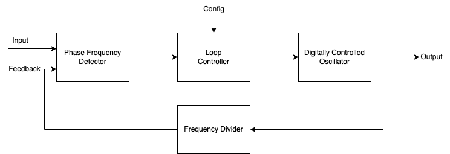

   Basic PLL Block Diagram

`xcore.ai` and `xcore-400` devices have on-chip a secondary PLL sometimes known as the Application
PLL. This PLL multiplies the clock from the on-board crystal source and has a fractional register
allowing very fine control over the multiplication and division ratios from software.
The secondary PLL output is available on pin X1D11 on `xcore.ai` and pins X0D39 and/or X1D11 on
`xcore-400`.

However, it does not support an external reference clock input and so cannot natively track and lock
to an external clock reference. This software PLL module provides a set of scripts and firmware which enables the
provision of an input reference clock which, along with a control loop, allows tracking of the external reference
over a certain range. It also provides a lower level API to allow tracking of virtual clocks rather than
physical signals such as when receiving digital samples from another device or packets over a network.

There are three Digitally Controlled Oscillator (DCO) implementations supported in
this library: Look-up Table (LUT), software Sigma-delta Modulator (SDM), and
hardware MASH on xcore-400. All three use a software PFD and PI controller to
track an external reference; they differ in how the application PLL is adjusted.
Their trade-offs are summarised in :numref:`table_lut_vs_dco`.

|beginfullwidth|

.. _table_lut_vs_dco:

.. list-table:: LUT, SDM and MASH DCO trade-offs
    :widths: 15 25 25 35
    :header-rows: 1

    * - Comparison item
      - LUT DCO
      - SDM DCO
      - MASH DCO
    * - Devices
      - xcore.ai and xcore-400
      - xcore.ai and xcore-400
      - xcore-400 only
    * - Jitter
      - Low, 1-2 ns
      - Very Low, 10-50 ps
      - Extremely Low, <10 ps
    * - Memory Usage
      - Low, ~2.5 kB
      - Low,  ~2 kB
      - Low,  ~2 kB
    * - MIPS Usage
      - Low - ~1
      - High - ~50
      - Low - ~1
    * - Lock Range PPM
      - Moderate, 100-1000
      - Wide, 1500-3000
      - Wide, up to6000

|endfullwidth|

.. note::
    When using ``xcore-400`` it is strongly recommended to use the MASH mode since it offers low
    resource usage along with excellent performance. LUT and SDM modes are retaind for compatibility reasons only.

.. note::
    The quoted LUT and SDM jitter values are measured using a frequency mask of
    100 Hz to 40 kHz as specified by AES-12id-2006. Actual jitter performance
    depends heavily on PLL settings and input clock quality.
    Use a low reference clock divider for best jitter performance.

LUT based DCO
=============

The LUT based DCO allows a discrete set of fractional settings resulting in a fixed number of frequency steps.
The LUT is pre-computed table which provides a set of monotonically increasing frequency register settings. The LUT
based DCO requires very low compute allowing it to be run in a sample-based loop at audio
frequencies such as 48kHz or 44.1kHz. It required two bytes per LUT entry and provides reasonable
jitter performance suitable for voice or entry level Hi-Fi. :numref:`fig_lut_pll` depicts a LUT DCO
based PLL

.. _fig_lut_pll:

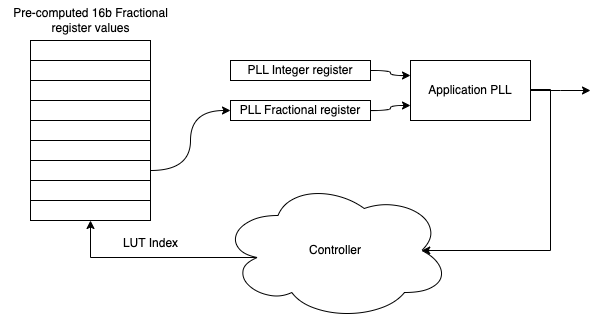

   LUT DCO based PLL

The range is governed by the look up table (LUT) which has a finite number of entries and consequently
has discrete frequency steps. This affects the output jitter performance when the controller oscillates between two
settings once locked. Note that the actual range and number of steps is highly configurable.
:numref:`fig_lut_dco_range` shows an example of LUT discrete output frequencies.

.. _fig_lut_dco_range:

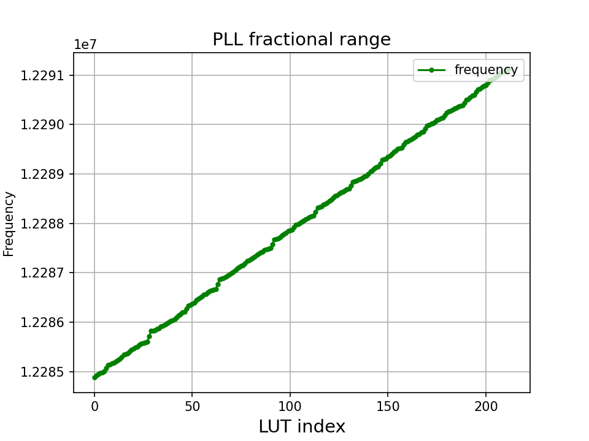

   Example of LUT discrete output frequencies

The index into the LUT is controlled by a
PI controller which multiplies the proportional error input, integral error input and double integral error input 
by the supplied loop constants.
An integrated `wind up` limiter for the integral term is nominally set at 2x the maximum LUT index
deviation to prevent excessive overshoot where the starting input error is high. A double integrator term
is also available to help zero phase error, which also has an integrated `wind up` limiter similar to the integral term.

:numref:`fig_tracking_lut` shows a time domain plot of how the controller (typically running at
around 100 Hz) selects between adjacent LUT entries. :numref:`fig_modulated_fft_lut` shows the
consequential frequency modulation effect.

.. _fig_tracking_lut:

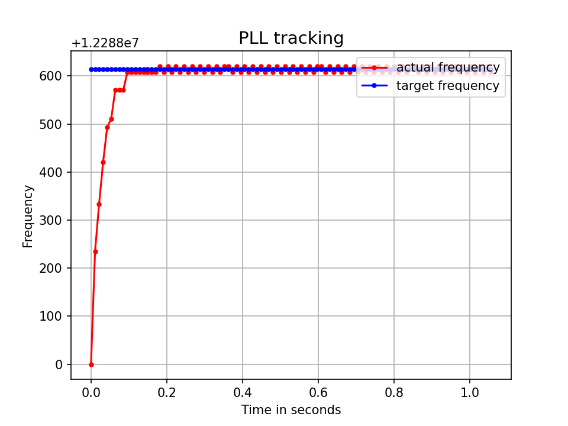

   LUT selection when tracking a constant input frequency

.. _fig_modulated_fft_lut:

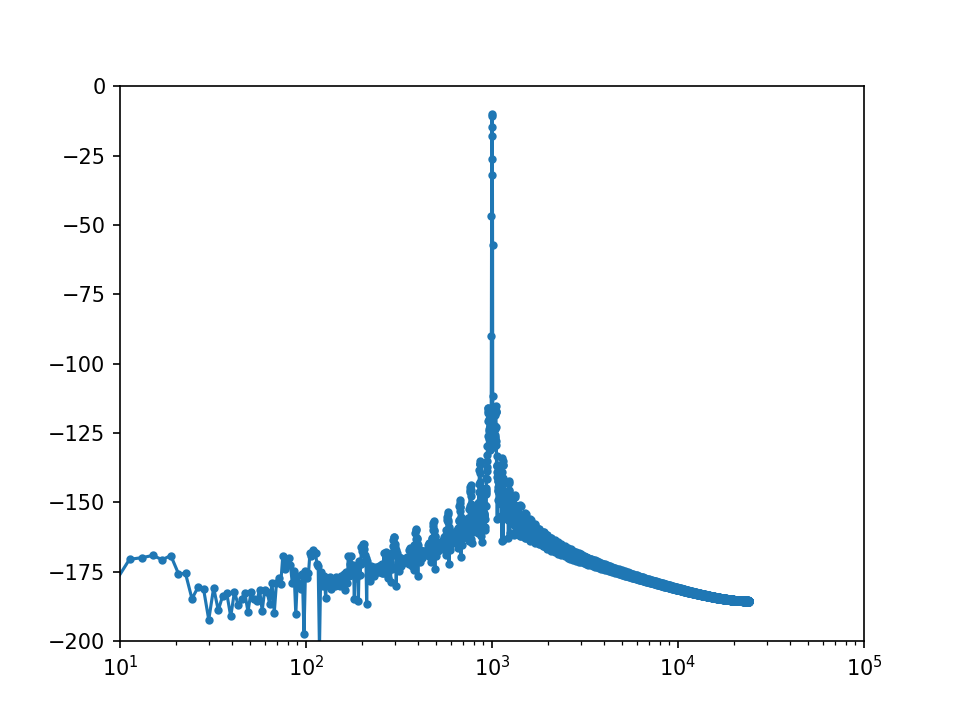

   LUT noise plot when when tracking a constant input frequency

|newpage|

SDM Based DCO
=============

The SDM based DCO provides a fixed number (9 in this case) of frequency steps which are jumped between
at a high rate (eg. 1 MHz) but requires a dedicated logical core to run the SDM algorithm and update the PLL
fractional register. The SDM is third order.

The SDM typically provides better audio quality by pushing the noise floor up into the
inaudible part of the spectrum. A fixed set of SDM coefficients and loop filters are provided which
have been hand tuned to provide either 24.576 MHz or 22.5792 MHz low jitter clocks and are suitable for Hi-Fi
and professional audio applications. :numref:`fig_sdm_pll` depicts a SDM DCO based PLL.

.. _fig_sdm_pll:

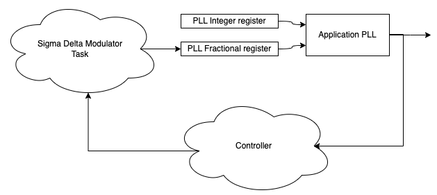

   SDM DCO based PLL

The steps for the SDM output are quite large which means a wide range is typically available.
:numref:`fig_sdm_dco_range` shows SDM discrete output frequencies.

.. _fig_sdm_dco_range:

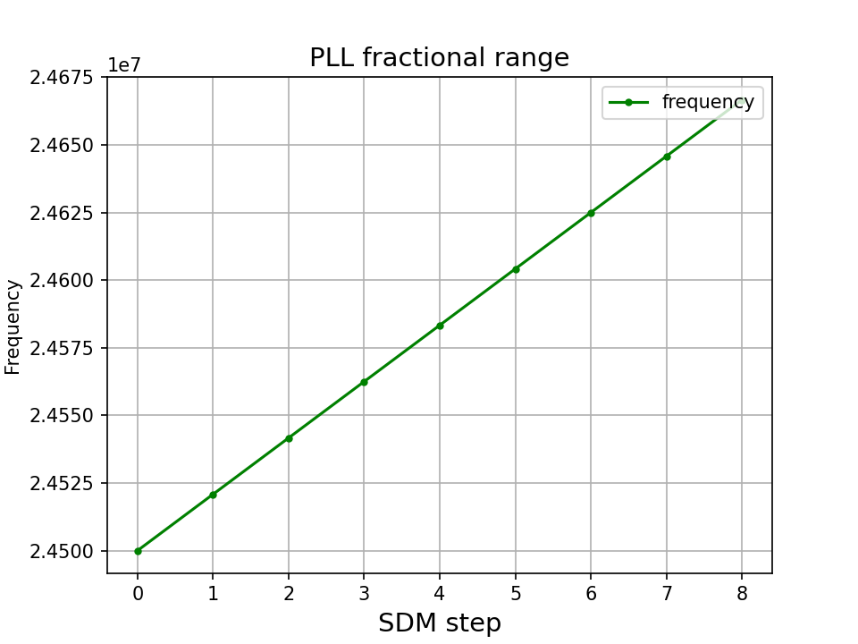

   SDM discrete output frequencies

:numref:`fig_sdm_tracking` shows a time domain plot of how the Sigma Delta Modulator jumps rapidly
between multiple frequencies. :numref:`fig_modulated_fft_sdm` shows the consequential spread of the
noise floor.

.. note::
    Both :numref:`fig_sdm_tracking` and :numref:`fig_modulated_fft_sdm` show the modulation effect
    for an perfect VCO which instantaneously follows the commanded frequency steps. In practice,
    the VCO will have a finite response time, which smooths out the rapid frequency transitions and
    reduces the observed noise spectrum.

.. _fig_sdm_tracking:

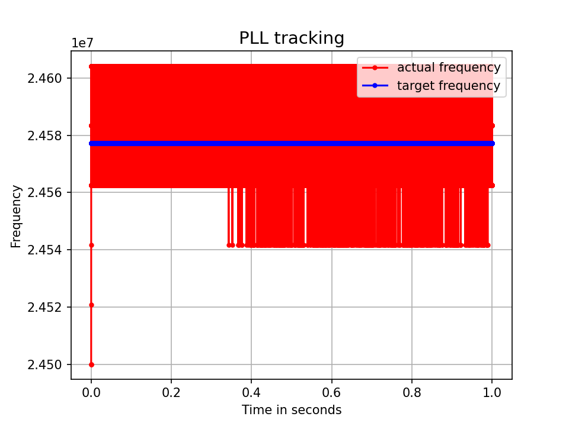

   SDM frequency selection when tracking a constant input frequency

.. _fig_modulated_fft_sdm:

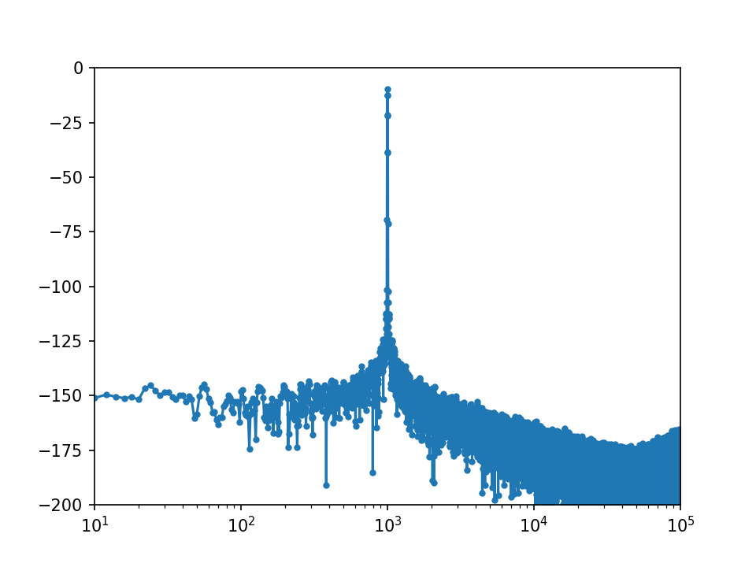

   SDM noise plot when when tracking a constant input frequency

|newpage|

MASH Based DCO
==============

xcore-400 provides a 3-stage hardware MASH 1-1-1 modulator in the application PLL's
fractional-feedback path. MASH cascades three first-order delta-sigma stages to
produce a sequence of integer divider corrections whose average represents the
requested fraction. Quantization noise is shaped towards higher frequencies.

Use of the hardware MASH mode for ``xcore-400`` users is strongly recommended.

The hardware MASH operates continuously and is distinct from the software SDM mode, which repeatedly 
writes PWM fractional settings from a dedicated task which cannot modulate as fast as the hardware MASH.

The MASH input is an unsigned 20-bit word, ``M``. Its fractional contribution is
``M / 2**20``: ``0x00000`` represents zero, ``0x80000`` represents 0.5, and
``0xFFFFF`` represents slightly less than one. Hardware adds corrections from
-3 through +4 to the programmed feedback setting, with the nominal average::

  average feedback ratio = (F + 1) + M / 2**20

Here ``F`` is the encoded feedback register field. The MASH word in the register has no
minus-one encoding unlike other PLL register fields. The integer reference and output dividers remain fixed
while software tunes the MASH word. Normal MASH operation disables the older
PWM fractional controller; ``sw_pll_mash_init()`` performs this setup internally.

For stability and phase noise reasons, ``lib_sw_pll`` imposes limits to the allowable MASH word range.
A very large PPM range of thousands of PPM still be achieved without requiring integer reconfiguration of the PLL.

The hardware continuously generates divider corrections from the PLL feedback
timing signal. Software need only update the MASH word when the control loop
runs, so no dedicated high-rate modulation task is required. Hardware
modulation does not replace the software PFD and PI controller needed to lock to
an external reference.

Unlike a PWM numerator/denominator pair, MASH has a uniform fractional step of
``2**-20``. The output step in Hz and the available tuning range depend on the
integer dividers.

Not every nominal frequency is exactly representable: when used to generate a fixed clock,
any quantization offset persists. However, in a closed software PLL the
controller can compensate for that offset within its available tuning range.

Neither an exact nominal calculation nor hardware noise shaping guarantees a
particular jitter performance. See `Generating MASH DCO settings`_ for optimal
settings and `MASH based PLL tuning`_ for control-loop considerations.

:numref:`fig_mash_tracking` shows a time domain plot of how the MASH Modulator jumps rapidly
between multiple frequencies. :numref:`fig_modulated_fft_mash` shows the consequential spread of the
noise floor.

.. note::
    Both :numref:`fig_mash_tracking` and :numref:`fig_modulated_fft_mash` show the modulation effect
    for an perfect VCO which instantaneously follows the commanded frequency steps. In practice,
    the VCO will have a finite response time, which smooths out the rapid frequency transitions and
    reduces the observed noise spectrum.

.. _fig_mash_tracking:

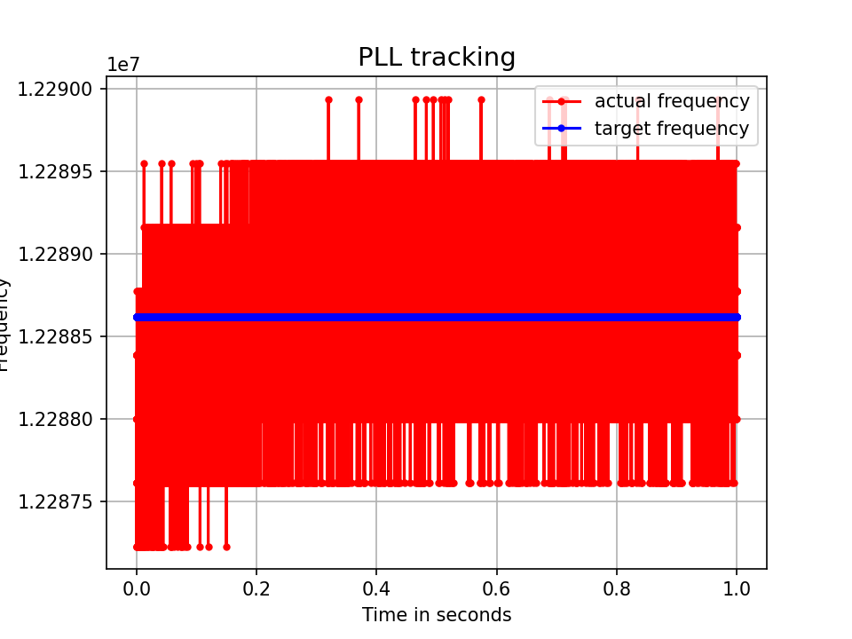

   MASH frequency selection when tracking a constant input frequency

.. _fig_modulated_fft_mash:

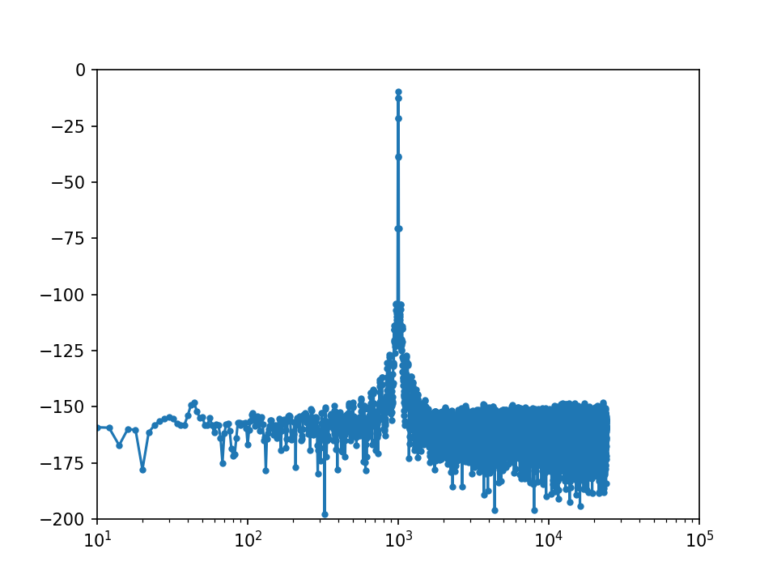

   MASH noise plot when when tracking a constant input frequency

|newpage|

Fixed Frequency Output Oscillator
=================================

A fixed (non phase-locked to external source) PLL setup API is also available which assumes a 24 MHz XTAL frequency and provides output
frequencies of 1.536 MHz, 3.072 MHz, 6.144 MHz, 11.2896 MHz, 12.288 MHz,
22.5792 MHz, 24.576 MHz, 45.1584 MHz or 49.152 MHz. See the `Common API`_ section.
These may be suitable for audio applications to generate a master clock from which you can derive common sample rates.

Output jitter for fixed clocks using a 100 Hz to 40 kHz mask is typically less than 8 ps.

The fixed clock API also supports setting the frequency to *0* which disables the PLL. This can be
helpful in systems where a low-power state is required. When disabled, pin X1D11 on `xcore.ai` or
pins X0D39 and/or X1D11 for `xcore-400` are reverted to port mode so that the user can choose to
set the state of this pin using normal I/O operations.

|newpage|

Phase Frequency Detector
========================

The Software PLL Phase Frequency Detector (PFD) detects frequency by counting clocks over a
specific time period. The clock counted is the output from the PLL and the time period over which
the count happens is a multiple of the input reference clock. This way the frequency difference
between the input and output clock can be directly measured by comparing the read count increment
with the expected count increment for the nominal case where the input and output are locked.

The PFD cannot directly measure phase, however, by taking the time integral of the frequency we can derive the phase which can be done
by the PI controller.

The PFD uses three chip resources:

- A one bit port to capture the PLL output clock - for `xcore.ai` this is always Port 1D on Tile[1].
  For `xcore-400` this is Port 1P on Tile[0] and/or Port 1D on tile[1].
- A clock block to turn the captured PLL output clock into a signal which can be distributed across the `xcore` tile
- An input port (either one already in use or an unconnected dummy port such as Port 32A) clocked from the above clock block. The in-built counter of this port
  can then be read and provides a count of the PLL output clock.

Two diagrams showing practical `xcore` resource setups are shown in the `Example application resource setup`_ section.

The port timers are 16 bits and so the PFD must account for wrapping because the overflow period at, for example, 24.576 MHz
is 2.67 milliseconds and a typical control period is in the order 10 milliseconds.

There may be cases where the port timer sampling time cannot be guaranteed to be fully isochronous, such as when a significant number of
instructions exist between a hardware event occur between the reference clock transition and the port timer sampling. In these cases
an optional input jitter reduction scheme is provided to allow scaling of the read port timer value. This scheme is used in the ``i2s_slave_lut``
example where the port timer read is precisely delayed until the transition of the next BCLK which removes the instruction timing jitter
that would otherwise be present. The cost is up to 1/64th of LR clock time of lost processing in the I²S callbacks
whilst waiting for the next BCLK edge, but the benefit is measurement jitter caused by variable instruction timing to be eliminated.

Proportional Integral Controller
================================

The PI controller uses fixed point (15Q16) types and 64 bit intermediate terms to calculate the error and accumulated error which are summed to produce the output. In addition a double integral term is included to allow calculation of the integral term of phase error, which itself
is the integral of the frequency error which is the output from the PFD.

Wind-up protection is included in the PI controller which clips the integral and double integral accumulator terms and is nominally
set to LUT size for the LUT based DCO and the control range for the SDM based DCO.

The SDM controller also includes a low-pass filter for additional error input jitter reduction.

See the `Tuning the Software PLL`_ section for information about how to optimise the PI controller.

****************
Simulation Model
****************

A complete model of the Software PLL is provided and is written in Python.

Contents
========

In the ``python/sw_pll`` directory you will find multiple files::

    .
    ├── analysis_tools.py
    ├── app_pll_model.py
    ├── controller_model.py
    ├── dco_model.py
    ├── pfd_model.py
    ├── pll_calc.py
    └── sw_pll_sim.py

These are all installable as a Python PIP module by running ``pip install -e .`` from the root of the repo.

Typically you do not need to access any file other than ``sw_pll_sim.py`` which brings in the other files as modules when run.

``sw_pll_sim.py`` may be run with the argument ``LUT``, ``SDM``, or ``MASH``
depending on which type of PLL you wish to simulate.

``analysis_tools.py`` contains audio analysis tools for assessing the frequency modulation of a tone from the jitter in
the recovered clock.

``controller_model.py`` models the PI controllers used in the Software PLL system.

``dco_model.py`` contains models of the LUT, software SDM, and hardware MASH
digitally controlled oscillators. The MASH model supports average-frequency
calculations and clock-stepped modulation, but does not model analog PLL
dynamics or physical output jitter. See the Python class and method docstrings
for configuration, usage, and timing details.

``pfd_model.py`` models the Phase Frequency Detector which is used when inputting a reference clock to the Software PLL.

``app_pll_model.py`` models the Application PLL hardware and allows reading/writing include files suitable for inclusion into `xcore`
firmware projects.

``pll_calc.py`` is the command line script that generates the LUT. It is quite a complex to use script which requires in depth
knowledge of the operation of the App PLL. Instead it is recommended to use ``app_pll_model.py`` which calls ``pll_calc.py`` which
wraps the script with sensible defaults, or better, use one of the provided profiles driven by ``sw_pll_sim.py``.

Generating MASH DCO settings
============================

For xcore-400 devices supporting MASH fractional feedback, ``pll_calc.py`` also has an
opt-in application-clock search. Existing integer/PWM commands and Python APIs
are unchanged. For example, from the repository root::

  python python/sw_pll/pll_calc.py --app --mash --input 24 --target 12.288 --error 0.01 --tuning-ppm 1000 --maxsol 5

Frequencies passed to this script are in MHz. This command searches for a
12.288 MHz application clock with at least +/-1000 ppm tuning range about the achieved
nominal frequency, using a fixed set of integer dividers. It includes both the
PLL macro's fixed divide-by-two and the application's duty-cycle divide-by-two.

The search rounds the required fractional ratio to a 20-bit MASH word and
checks the resulting nominal error against ``--error`` using rational
arithmetic on the specified decimal frequencies. MASH mode has no hidden error
allowance: the default ``--error 0`` requires an exactly representable frequency
and can return no solutions. Use an explicit fractional limit such as
``--error 0.01`` to allow up to 0.01 ppm of nominal target frequency error.

MASH mode does not search PWM fractions or generate a PWM LUT. ``--denmax``,
``--header``, and fractional ``--fracmin``/``--fracmax`` settings cannot be
combined with ``--mash``.

``--mash-min`` and ``--mash-max`` default to 0.1 and 0.9. These are conservative
tuning-policy limits, not hardware requirements or a guarantee of low jitter.
Candidates are ranked by available symmetric ppm range, nominal accuracy, and
then divider preferences. ``--raw`` retains enumeration order instead. The
``--maxsol`` limit is applied after searching, so the default ranking can select
the best available candidates rather than the first configurations encountered.
Quantized tuning endpoints also respect the average VCO and PLL-output limits.
The search assumes the documented 13-bit F field and reserves room for the
instantaneous MASH corrections from -3 through +4. A device with a narrower F
interface needs tighter feedback-divider limits.

Each solution prints the control and final-divider registers and
``APP_PLL_MASH_REG``. No PWM register definition is needed because
``sw_pll_mash_init`` disables PWM internally. The MASH value is the raw nominal 20-bit payload
used by the MASH example/driver, not a hardware register image including an
enable bit. Please refer to the xcore-400 documentation, specifically the CSR_PLL1_FRACN_MASH register.
Integer divider fields are minus-one encoded; the MASH word is not.

The output also gives the frequency step in Hz per MASH LSB and the available
tuning-word limits. If the nominal word is ``M0`` and the printed step is ``s``
Hz/LSB, a software PLL requesting an offset ``delta_hz`` can use
``M0 + round(delta_hz / s)``, clamped to the reported limits. Keep the integer
dividers unchanged while tuning. Noise and tones must still be characterized
on the target hardware across the intended operating range.

Running the PI simulation
=========================

The python script ``sw_pll_sim.py`` is used to run the PI simulation and optionally generate the LUT for the software PLL.
The arguments ``LUT``, ``SDM`` or ``MASH`` specify which type of simulation or output to generate.

By running ``sw_pll_sim.py LUT`` a number of operations will take place:

 - The ``fractions.h`` LUT include file will be generated (LUT PLL only - this is not needed by SDM)
 - The ``register_setup.h`` PLL configuration file will be generated for inclusion in your `xcore` project.
 - A graphical view of the LUT settings showing index vs. output frequency is generated.
 - A time domain simulation of the PI loop showing the response to steps and out of range reference inputs is run.
 - A wave file containing a 1 kHz modulated tone for offline analysis.
 - A log FFT plot of the 1 kHz tone to see how the PLL frequency steps affect a pure tone.
 - A summary report of the PLL range is also printed to the console.

The directory listing following running of ``sw_pll_sim.py`` will be added to as follows::

    .
    ├── fractions.h
    ├── register_setup.h
    ├── tracking_lut.png
    ├── tracking_sdm.png
    ├── tracking_mash.png
    ├── modulated_tone_1000Hz_lut.wav
    ├── modulated_tone_1000Hz_sdm.wav
    ├── modulated_tone_1000Hz_mash.wav
    ├── modulated_fft_lut.png
    ├── modulated_fft_sdm.png
    └── modulated_fft_mash.png

:numref:`fig_pll_step_response` shows the step response of the control loop when the target
frequency is changed during the simulation.
You can see it track smaller step changes but for the larger steps it can be seen to clip and not
reach the input step, which is larger than the used LUT size will allow. The LUT size can be
increased if needed to accommodate a wider range.

The step response is quite fast and you can see even a very sharp change in frequency is
accommodated in just a handful of control loop iterations.

.. _fig_pll_step_response:

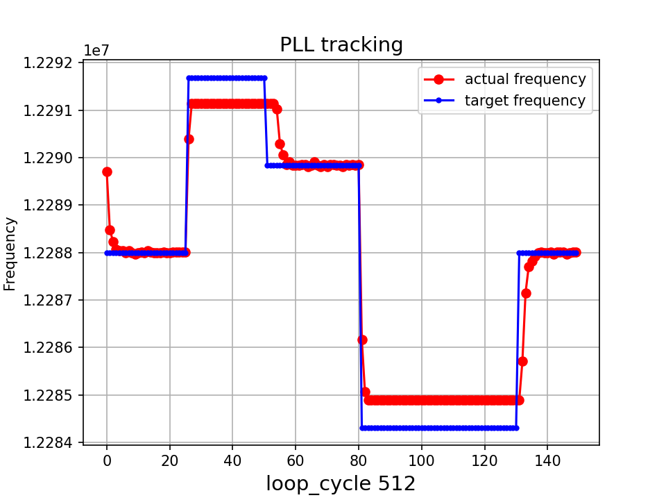

    PLL step response

|newpage|

***********************
Tuning the Software PLL
***********************

LUT based PLL Tuning
====================

PI controller
-------------

Typically the PID loop tuning should start with 0 *Kp* term and a small (e.g. 1.0) *Ki* term.

 - Decreasing the ref_to_loop_call_rate parameter will cause the control loop to execute more frequently and larger constants will be needed.
 - Try tuning *Ki* value until the desired response curve (settling time, overshoot etc.) is achieved in the ``tracking_xxx.png`` output.
 - *Kp* can normally remain zero, but you may wish to add a small value to improve step response

.. note::
    After changing the configuration, ensure you delete `fractions.h` otherwise the script will re-use the last calculated values.
    This is done to speed execution time of the script by avoiding the generation step.

A double integral term is supported in the PI loop because the clock counting PFD included measures
the frequency error. The phase error is the integral of the frequency error and hence if phase locking
is required as well as frequency locking then we need to support the integral of the integral of
the frequency error.  Changing the Kp, Ki and Kii constants and observing the simulated (or hardware response)
to a reference change is all that is needed in this case.

.. note::
    In the python simulation file ``sw_pll_sim.py``, the PI constants *Kp*, *Ki* and optionally *Kii* can be found in the functions `run_lut_sw_pll_sim()` and `run_sd_sw_pll_sim()`.

Typically a small Kii term is used, if needed, because it accumulates very quickly.

LUT example configurations
--------------------------

The LUT implementation requires an offline generation stage which has many possibilities for customisation.

A number of example configurations, which demonstrate the effect on PPM, step size etc. of changing various parameters, is provided in the ``sw_pll_sim.py`` file.
Search for ``profiles`` and ``profile_choice`` in this file. Change profile choice index to select the different example profiles and run the python file again.

.. list-table:: Example LUT DCO configurations
   :widths: 50 50 50 50 50
   :header-rows: 1

   * - Output frequency MHz
     - Reference frequency kHz
     - Range +/- PPM
     - Average step size Hz
     - LUT size bytes
   * - 12.288
     - 48.0
     - 250
     - 29.3
     - 426
   * - 12.288
     - 48.0
     - 500
     - 30.4
     - 826
   * - 12.288
     - 48.0
     - 1000
     - 31.0
     - 1580
   * - 24.576
     - 48.0
     - 500
     - 60.8
     - 826
   * - 24.576
     - 48.0
     - 100
     - 9.5
     - 1050
   * - 6.144
     - 16.0
     - 150
     - 30.2
     - 166

.. note::
    The physical PLL actually multiplies the input crystal, not the reference input clock.
    It is the PFD and software control loop that detects the frequency error and controls the fractional register to make the PLL track the input.
    A change in the reference input clock parameter only affects the control loop and its associated constants such as how often the PI controller is called.

Custom LUT Generation Guidance
------------------------------

The fractions lookup table is a trade-off between PPM range and frequency step size. Frequency
step size will affect jitter amplitude as it is the amount that the PLL will change frequency when it needs
to adjust. Typically, the locked control loop will slowly oscillate between two values that
straddle the target frequency, depending on input frequency.

Small discontinuities in the LUT may be experienced in certain ranges, particularly close to 0.5 fractional values, so it is preferable
to keep in the lower or upper half of the fractional range. However the LUT table is always monotonic
and so control instability will not occur for that reason. The range of the LUT Software PLL can be seen
in the ``lut_dco_range.png`` image. It should be a reasonably linear response without significant
discontinuities. If discontinuities are seen, try moving the range towards 0.0 or 1.0 where fewer discontinuities may
be observed due the step in the fractions.

Steps to vary the LUT PPM range and frequency step size
-------------------------------------------------------

  #. Ascertain your target PPM range, step size and maximum tolerable table size. Each lookup value is 16 bits so the total size in bytes is 2 * n.
  #. Start with the given example values and run the generator to see if the above three parameters meet your needs. The values are reported by ``sw_pll_sim.py``.
  #. If you need to increase the PPM range, you may either:

      * Decrease the ``min_F`` to allow the fractional value to have a greater effect. This will also increase step size. It will not affect the LUT size.
      * Increase the range of ``fracmin`` and ``fracmax``. Try to keep the range closer to 0 or 1.0. This will decrease step size and increase LUT size.

  #. If you need to decrease the step size you may either:

      * Increase the ``min_F`` to allow the fractional value to have a greater effect. This will also reduce the PPM range. When the generation script is run the allowable F values are reported so you can tune the ``min_F`` to force use of a higher F value.
      * Increase the ``max_denom`` beyond 80. This will increase the LUT size (finer step resolution) but not affect the PPM range. Note this will increase the intrinsic jitter of the PLL hardware on chip due to the way the fractional divider works. 80 has been chosen for a reasonable tradeoff between step size and PLL intrinsic jitter and pushes this jitter beyond 40 kHz which is out of the audio band. The lowest intrinsic fractional PLL jitter freq is input frequency (normally 24 MHz) / ref divider / largest value of n.

  #. If the +/-PPM range is not symmetrical and you wish it to be, then adjust the ``fracmin`` and ``fracmax`` values around the center point that the PLL finder algorithm has found. For example if the -PPM range is too great, increase ``fracmin`` and if the +PPM range is too great, decrease the ``fracmax`` value.

.. note::
    When the process has completed, inspect the ``lut_dco_range.png`` output figure which shows
    how the fractional PLL setting affects the output frequency.
    This should be monotonic and not contain an significant discontinuities for the control loop to
    operate satisfactorily.

SDM based PLL tuning
====================

SDM available configurations
----------------------------

The SDM implementation only allows tuning of the PI loop; the DCO section is hand optimised for the provided profiles shown
below. There are two target PLL output frequencies and two options for SDM update rate depending on how much performance
is available from the SDM task.

.. list-table:: SDM DCO configurations
   :widths: 50 50 50 50 50
   :header-rows: 1

   * - Output frequency MHz
     - Range +/- PPM
     - Jitter ps
     - Noise Floor dBc
     - SDM update rate kHz
   * - 24.576
     - 3000
     - 10
     - -100
     - 1000
   * - 22.5792
     - 3300
     - 10
     - -100
     - 1000
   * - 24.576
     - 1500
     - 50
     - -93
     - 500
   * - 22.5792
     - 1500
     - 50
     - -93
     - 500

The SDM based DCO Software PLL has been pre-tuned and should not need modification in normal circumstances. Due to the large control range values
needed by the SDM DCO, a relatively large integral term is used which applies a gain term. If you do need to tune the SDM DCO PI controller then
it is recommended to start with the provided values in the example in ``/examples/app_simple_sdm``.

MASH based PLL tuning
=====================

Generate nominal settings using `Generating MASH DCO settings`_, choosing an
explicit nominal error tolerance and enough symmetric tuning headroom for the
expected input-clock variation. Put the selected ``APP_PLL_CTL_REG``,
``APP_PLL_DIV_REG``, and raw ``APP_PLL_MASH_REG`` values in the application's
``register_setup.h``. No frequency LUT or software SDM profile is required.

The controller adjusts the nominal MASH word in units of one 20-bit LSB.
Consequently, LUT or software SDM gains are not directly interchangeable with
MASH gains. Start from ``examples/app_simple_mash/src/simple_mash.c`` and tune
``Kp``, ``Ki``, and ``Kii`` for the actual reference and control-loop rate.
The example samples a 48 kHz reference and uses ``loop_rate_count = 512``,
giving a nominal control rate of 93.75 Hz. This is the software update rate,
not the much faster hardware modulation rate which operates once per input clock (nominally 24 MHz).

The calculator's ``--tuning-ppm`` is a search requirement, not a firmware clamp.
Likewise, ``--mash-min`` and ``--mash-max`` limit the search window only. The
current controller clips its output to ``0x1999A`` through ``0xE6666`` and
reports an unlocked status when the requested control word exceeds that range.
These inward-rounded 20-bit limits enforce the recommended 0.1 to 0.9 window.
Changing the calculator's window does not change these firmware limits.
The initialization parameter ``ppm_range`` sets the PFD's excessive-error reset
threshold, nominally twice that range; it does not impose MASH tuning-word limits.

The firmware limits are defined in ``sw_pll_mash.h``:

.. literalinclude:: ../../lib_sw_pll/src/sw_pll_mash.h
  :language: c

Ensure the PPM difference stays within the intended word window and legal PLL operating range, including during
startup and loss of reference.
Validate settling, lock behavior, and output jitter on hardware across the intended operating range.

Transferring the results to C
------------------------------

Once the LUT has been generated or SDM/MASH profile selected and has simulated in Python, the values can be transferred to the firmware application. Control loop constants
can be directly transferred to the `init()` functions and the generated `.h` files can be copied directly into the source directory
of your project.

For further information, either consult the ``sw_pll.h`` API file (included at the end of this document) or follow one of the examples in the ``/examples`` directory.

**********************************
Example application resource setup
**********************************

The `xcore.ai` device has a number of resources on chip which can be connected together to manage signals and application clocks.
In the provided examples both `clock blocks` and `ports` are connected together to provide an input to
the PFD which calculates frequency error. Resources additionally provide an optional prescaled output clock for comparison with the input reference.

Simple example resource setup
=============================

The output from the PLL is counted using a port timer via the `clk_mclk` clock block.

In addition, a precise timing barrier is implemented by clocking a dummy port from the clock block
clocked by the reference clock input. This effectively rate limits the while(1) control loop.
Since the very next instruction reads the port timer, there is very little jitter in this measurement.

The resource setup code is contained in ``resource_setup.h`` and ``resource_setup.c`` using intrinsic functions in ``lib_xcore``.
To help visualise how these resources work together, see :numref:`fig_resources`.

.. _fig_resources:

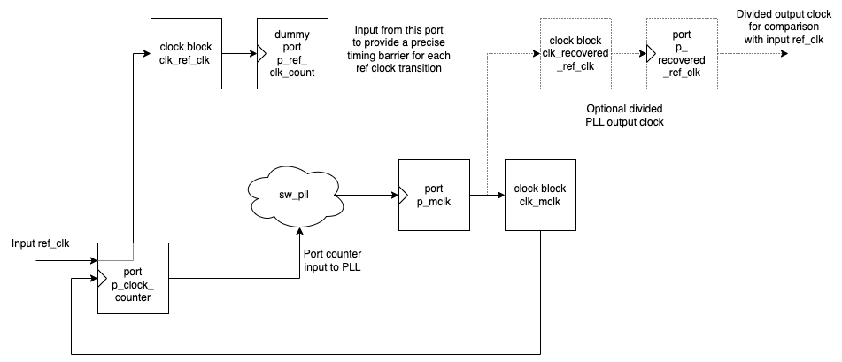

   Use of Ports and Clock Blocks in the simple examples

The dotted lines and resources are merely to provide a hardware-divided PLL output of the same frequency as the reference
to allow easy comparison and verification of the PLL output against the reference clock using an oscilloscope.

I²S slave example resource setup
================================

The I²S slave component already uses a clock block which captures the bit clock input. In addition
to this, the PLL output is used to clock a dummy port's counter which is used as the input to the PFD.

Since the sampling time of the PLL output clock count is variable due to instruction timing between
the I²S LRCLK transition and the capture of the PLL output clock count in the I²S callback, which may be many instructions,
an additional dummy port is used.
This precisely synchronises the capture of the PLL output clock count relative to the BCLK transition and
the relationship between these is used to reconstruct the absolute frequency difference with minimal input jitter.

:numref:`fig_resources_i2s` shows the resource arrangement of the I2S slave example.

.. _fig_resources_i2s:

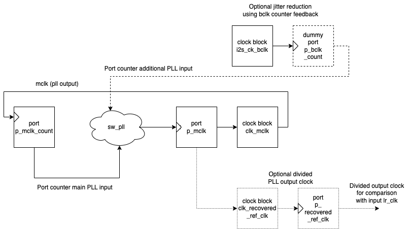

   Use of Ports and Clock Blocks in the I²S slave example

****************
Software PLL API
****************

The Application Programmer Interface (API) for the Software PLL is shown below.
It is split into items specific to LUT, software SDM, and xcore-400 hardware MASH DCOs.

In addition to the standard API which takes a clock counting input (implements the PFD), for applications where the PLL is
to be controlled using an alternatively derived error input, a low-level API is also provided. This low-level
API allows the Software PLL to track an arbitrary clock source which is calculated by other means such as timing of received packets
over a communications interface.

LUT Based PLL API
=================

The LUT based API are functions designed to be called from an audio loop. Typically the functions can take up to 210 instruction cycles when control occurs and just a few 10s of cycles when control does not occur. If run at a rate of 48 kHz then it will consume approximately 1 MIPS on average.

.. doxygengroup:: sw_pll_lut
    :content-only:

SDM Based PLL API
=================

All SDM API items are function calls. The SDM API requires a dedicated logical core to perform the SDM calculation and periodic register write and it is expected that the user provide the fork (par) and call to the SDM.

A typical design idiom is to have the task running in a loop with a timing barrier (either 1 us or 2 us depending on profile used) and a non-blocking channel poll which allows new DCO control values to be received as needed at the control loop rate. The SDM calculation and register write takes 45 instruction cycles and so with the overheads of the timing barrier and the non-blocking channel receive poll, a minimum 60 MHz logical core should be set aside for the SDM task running at 1 us period.
This can be approximately halved it running at 2 us SDM period.

The control part of the SDM SW PLL takes 75 instruction cycles when active and a few 10 s of cycles when inactive so you will need to budget around 1 MIPS for this when
being called at 48 kHz with a control rate of one in every 512 cycles.

An example of how to implement the threading, timing barrier and non-blocking channel poll can be found in ``examples/simple_sdm/simple_sw_pll_sdm.c``. A thread diagram of how this can look is shown below.

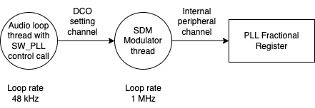

   Example Thread Diagram of SDM SW PLL

.. doxygengroup:: sw_pll_sdm
    :content-only:

MASH Based PLL API
==================

The MASH functions are declared in ``sw_pll.h`` when building for xcore-400
(guarded by the define ``__VX4B__``).

- ``sw_pll_mash_init()`` initializes the PLL, controller, and PFD. Pass the
  control and final-divider register values, the raw nominal 20-bit MASH word,
  the PI gains, sampling parameters, ``ppm_range``, and output ``tile_mask``.
  Check the returned ``sw_pll_result_t`` before running the control loop.
- ``sw_pll_mash_do_control()`` takes sampled output/reference port-timer counts.
  Call it once per reference sampling event. The controller runs every
  ``loop_rate_count`` calls and returns the current ``sw_pll_lock_status_t``.
- ``sw_pll_mash_do_control_from_error()`` accepts an externally calculated
  signed 16-bit error and executes a controller update on each call.

See ``examples/app_simple_mash/src/simple_mash.c`` for an initialization and
sampling-loop example, and `MASH based PLL tuning`_ for tuning limits.

Common API
==========

.. doxygengroup:: sw_pll_common
    :content-only:

*********************************
Building and running the examples
*********************************

This section assumes you have downloaded and installed the `XMOS XTC tools <https://www.xmos.com/software-tools/>`_
(see `README` for required version).
Installation instructions can be found `here <https://xmos.com/xtc-install-guide>`_.

Particular attention should be paid to the section `Installation of required third-party tools
<https://www.xmos.com/documentation/XM-014363-PC-10/html/installation/install-configure/install-tools/install_prerequisites.html>`_.

The application examples uses the `xcommon-cmake <https://www.xmos.com/file/xcommon-cmake-documentation/?version=latest>`_
build system as bundled with the XTC tools.

Select an XTC toolchain supporting the target device. For example, build the
xcore.ai LUT application from ``lib_sw_pll/examples/app_simple_lut``::

    cmake -B build -G "Unix Makefiles"
    xmake -C build

  Build other examples from their own application directories in the same way.
  The top-level examples project includes both xcore.ai targets and the
  xcore-400-only MASH target, which require their corresponding toolchains.

  To run the xcore.ai firmware from ``lib_sw_pll/examples``, use one of the
  following commands.

*app_fixed_clock* demonstrates the fixed clock API and requires no hardware connections.

For *app_simple_lut* and *app_simple_sdm*, first connect `LRCLK` and `BCLK` (connects the test
clock output to the PLL reference input).

*app_fixed_clock*, *app_simple_lut*, and *app_simple_sdm* run on the `XK-EVK-XU316` board.
*app_i2s_slave_lut* requires the `XK-VOICE-SQ66` board::

    xrun --xscope app_fixed_clock/bin/app_fixed_clock.xe
    xrun --xscope app_simple_lut/bin/app_simple_lut.xe
    xrun --xscope app_simple_sdm/bin/app_simple_sdm.xe
    xrun --xscope app_i2s_slave_lut/bin/app_i2s_slave_lut.xe

For `app_fixed_clock.xe`, the application demonstrates the `sw_pll_fixed_clock()` API
by cycling the PLL output between 24.576 MHz and 0 Hz (disabled) with 5-second intervals.
This example requires no hardware connections and can be observed by placing an oscilloscope
probe on pin X1D11 (tile[1]). The pin will output a 24.576 MHz clock for 5 seconds, then
be disabled (reverted to port control) for 5 seconds, repeating indefinitely. This demonstrates
both enabling the PLL at a fixed frequency and powering it down.

For `app_simple_lut.xe` and `app_simple_sdm.xe`, to see the PLL lock, put a oscilloscope probe on
either `LRCLK`/`BCLK` (reference input) and another on `PORT_I2S_DAC_DATA` to see the
recovered clock which has been hardware divided back down to the same rate as the input reference
clock.

For `i2s_slave_lut.xe` you will need to connect a 48 kHz I²S master to the `LRCLK`, `BCLK` pins.
You may then observe the I²S input data being
looped back to the output and the `MCLK` being generated. A divided version of MCLK is output on
`PORT_I2S_DATA2` which allows
direct comparison of the input reference (`LRCLK`) with the recovered clock at the same, and locked,
frequency.

MASH example on xcore-400
=========================

``app_simple_mash`` targets the ``XK-EVK-XU416`` board. From an XTC command
prompt using xcore-400 tools, build and run it in
``lib_sw_pll/examples/app_simple_mash``::

  cmake -B build-vx -G "Unix Makefiles"
  xmake -C build-vx
  xrun --xscope bin/app_simple_mash.xe

The example configures a nominal 12.288 MHz application clock on tile[1] and
generates a separate 48 kHz test reference. Before running, connect the test
reference output on tile[1] port 1B to the reference input on tile[1] port 1F
(X1D13). Alternatively, supply an external 48 kHz reference to that input
without also connecting the test generator.

The application-clock output is captured on port 1D (X1D11); a recovered
48 kHz clock is output on port 1E (X1D12). Compare the input reference and
recovered clock on an oscilloscope to observe locking and frequency tracking. The sampling and
controller run in software, but the high-rate MASH modulation runs in hardware.

